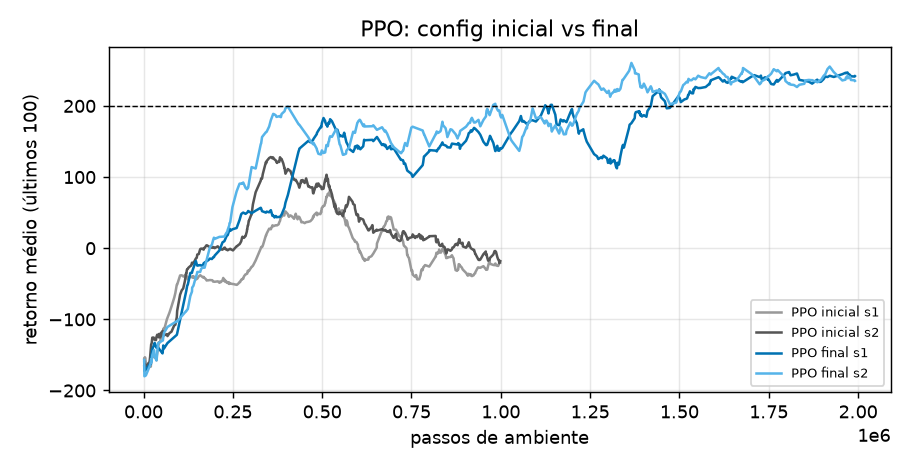
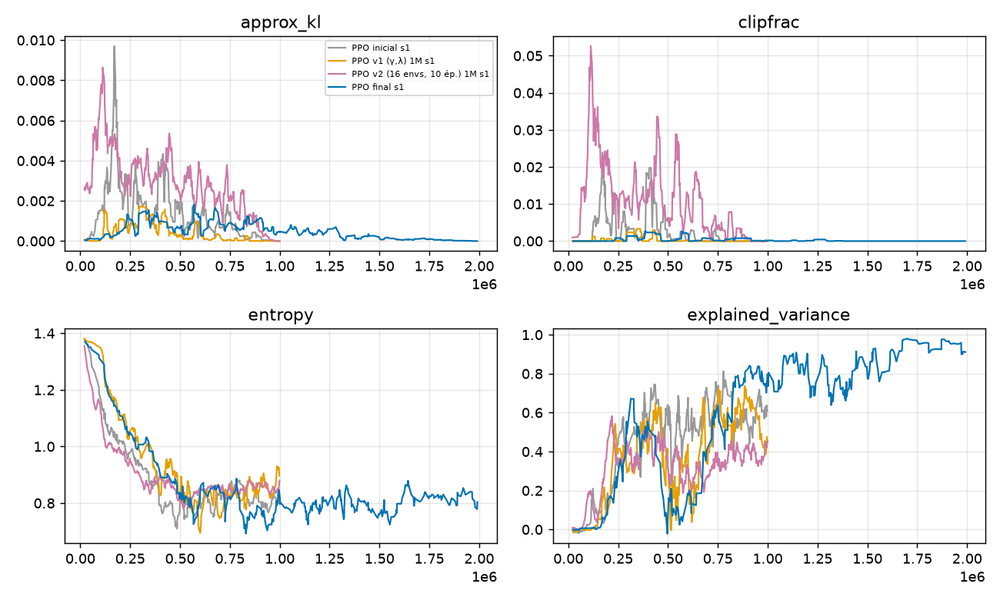
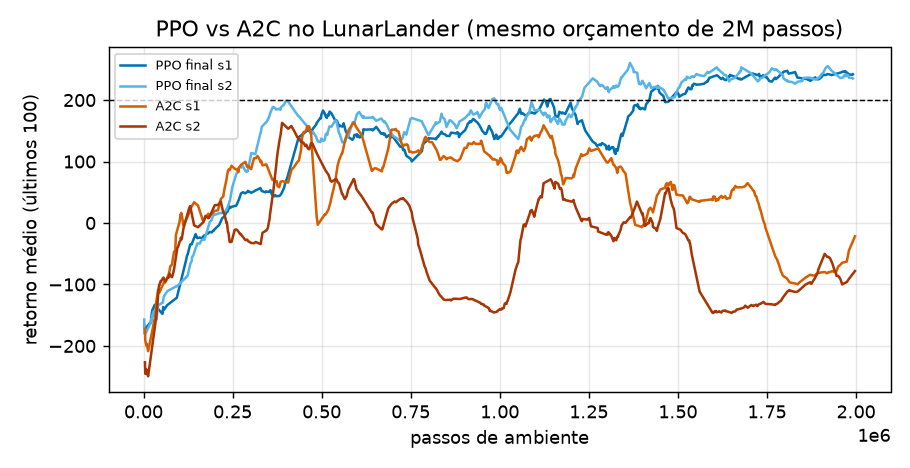
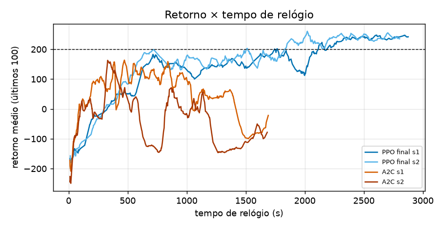
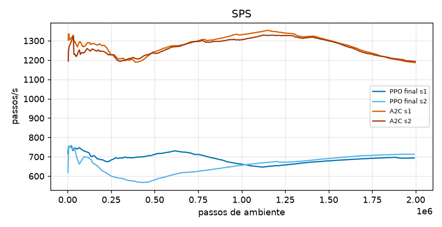

# Relatório — PPO no LunarLander-v3 (Partes 4 e 5)

Autoria: João Arthur Xavier Marques (individual).
Código: branch local `ppo-work` do clone de `BrunoBSM/t-zero-learning` (arquivos `algorithms/ppo.py`, `algorithms/a2c.py`, `networks/discrete_actor_critic.py`, configs `configs/ppo_lunarlander.yml` e `configs/ppo_lunarlander_final.yml`). Fork: https://github.com/Arthur-Marques-IA/t-zero-learning (branch `ppo-work`).
Runs: W&B `joao_arthur-federal-university-of-goi-s/ppo-assignment`. Figuras e números vêm de `reports/runs.json` (`fetch_runs.py`) processado por `analyze.py`.

Testes: `pytest tests/test_ppo.py tests/test_a2c.py` → 34 passam.

## Resultado resumido

O PPO resolve o LunarLander nas 2 seeds com 2M passos (critério: `eval/mean_return` ≥ 200 e `episodic_return_mean_last100` ≥ 200 no fim).

| Run | W&B id | seed | passos | `return_last100` | `eval/mean_return` (±std, 10 ep.) |
|---|---|---|---|---|---|
| PPO inicial | s85oibgl | 1 | 1M | -19,4 | 20,5 ± 127,8 |
| PPO inicial | p0vuk9dt | 2 | 1M | -16,4 | 63,4 ± 120,1 |
| v1 (γ, λ) | u8mg9q9e | 1 | 1M | 101,3 | 140,2 ± 105,3 |
| v2 (16 envs, 10 épocas) | bhhqzxcq | 1 | 1M | -5,9 | -9,5 ± 135,9 |
| **PPO final** | 5pdayags | 1 | 2M | **239,1** | **253,1 ± 17,2** |
| **PPO final** | dzm2xwfo | 2 | 2M | **242,4** | **204,3 ± 86,1** |
| A2C | cr63uqu9 | 1 | 2M | -15,8 | 25,9 ± 110,6 |
| A2C | prbn0gm8 | 2 | 2M | -76,8 | -62,5 ± 68,4 |

Observação: na seed 2 o critério passa, mas a avaliação final tem desvio de 86 (alguns dos 10 episódios ficam bem abaixo de 200); a seed 1 é bem mais regular (desvio 17).

## Parte 4 — Do config inicial ao final

### Tabela de mudanças (config inicial → final)

| Chave | Antigo → novo |
|---|---|
| `total_timesteps` | 1.000.000 → 2.000.000 |
| `ppo.gamma` | 0,99 → 0,999 |
| `ppo.gae_lambda` | 0,95 → 0,98 |

Todo o resto fica igual ao config inicial (`num_envs=4`, `num_steps=128`, `update_epochs=4`, `num_minibatches=4`, `clip_coef=0.2`, `ent_coef=0.01`, `learning_rate=2.5e-4` com anneal). O config final está em `configs/ppo_lunarlander_final.yml`.

### Caminho, com o motivo observado

**1. Config inicial (runs s85oibgl e p0vuk9dt).** Aprende e depois degrada. `return_last100` chega a um pico (78 na seed 1, 128 na seed 2) e cai para cerca de -20 no fim (Figura 1, curvas cinzas). Os diagnósticos (Figura 2): `approx_kl` ≈ 2e-3→4e-4 (seed 1) e `clipfrac` ≈ 0,5% → 0,03%, ou seja, a política se move pouco a cada atualização e o clipping quase nunca atua. A `explained_variance` termina em ~0,61 / 0,65, e a `entropy` cai de ~1,1 para ~0,83. O que se vê é um crítico mediano e uma política que perde o que tinha ganho.

**2. v2 — `num_envs` 4→16 e `update_epochs` 4→10 (bhhqzxcq): não deu certo.** Motivação: os diagnósticos acima sugeriam rollouts subaproveitados (`clipfrac` ~0, `approx_kl` pequeno), então mais épocas deveriam extrair mais de cada rollout. Efeito observado: o reuso de fato mexeu mais na política (`clipfrac` 1,7% → 0,2% e `approx_kl` 4e-3 → 1,2e-3, bem acima do inicial), mas o retorno não melhorou (`return_last100` -5,9, avaliação -9,5) e a `explained_variance` ficou pior (0,37 no fim, contra 0,61 do inicial). Houve também menos atualizações no mesmo orçamento (19.520 contra 31.248, porque o batch passou de 512 para 2.048 amostras). Como mudei duas coisas juntas, não sei separar qual causou o resultado; só posso dizer que mais reuso, sozinho, não resolveu e que o crítico continuou sendo o ponto fraco.

**3. v1 — `gamma` 0,99→0,999 e `gae_lambda` 0,95→0,98 (u8mg9q9e, 1M passos).** Motivação: no LunarLander o retorno é dominado por um termo terminal grande (pouso/queda) e os episódios são longos; com γ=0,99 o horizonte efetivo (~100 passos) corta boa parte do caminho até esse termo, e um λ maior reduz o viés do alvo do crítico. Esse raciocínio foi uma hipótese minha, não algo lido diretamente dos gráficos. Resultado: `return_last100` 101 e avaliação 140, contra -19 e 20 do inicial na mesma seed (Figura 2, laranja), e o `approx_kl` ficou menor (6e-4 → 1e-4). Ressalva importante: é uma seed só, e o PPO inicial seed 2 também chegou a ~128 no meio do treino antes de cair, então a diferença de 1M passos entre v1 e inicial está dentro do que as seeds já variam; sozinha, ela não prova o efeito. Também não rodei γ e λ separadamente.

**4. Final — o mesmo config da v1 com 2M passos (5pdayags, dzm2xwfo).** Motivação: no run v1 a curva ainda estava subindo/oscilando em 1M passos (pico 140). Resultado: as duas seeds cruzam 200 e ficam lá (Figura 1, azuis): pico 248/260, `return_last100` final 239/242. A `explained_variance` sobe para 0,86 / 0,91 no fim e a `entropy` cai de ~1,0 para ~0,8, sem colapsar.

**O que não consigo afirmar.** O config final difere do inicial em três coisas ao mesmo tempo (γ, λ e orçamento). Não rodei o config inicial com 2M passos, nem o final com γ e λ originais, então não dá para dizer quanto do ganho vem de cada uma. A evidência que tenho é: (a) inicial com 2 seeds não resolve em 1M, (b) v1 com 1 seed melhora, mas ainda não chega a 200 em 1M, (c) final com 2 seeds resolve em 2M. O que sustenta "γ/λ ajudam" é só o ponto (b) mais a hipótese do horizonte, com uma seed.

### Figuras da Parte 4

- Figura 1 — `reports/fig1_init_vs_final.png`: retorno (últimos 100) do config inicial e do final, 2 seeds cada.
- Figura 2 — `reports/fig2_diagnostics.png`: `approx_kl`, `clipfrac`, `entropy` e `explained_variance` para inicial, v1, v2 e final (seed 1).

## Parte 5 — PPO vs A2C no LunarLander

**Como o A2C foi rodado.** `a2c_cartpole` com `env_id=LunarLander-v3`, `total_timesteps=2000000` e `a2c.gamma=0.999`; o resto fica igual (8 envs, `num_steps=5`, `lr=7e-4` constante, `ent_coef=0.01`). Não ajustei mais nada. Ou seja, é uma tentativa só razoável, e as conclusões abaixo valem para este A2C, não para o melhor A2C possível. 2 seeds de cada algoritmo, 2M passos. O PPO é o config final.

### Eficiência amostral

Passos para a média móvel `return_last100` chegar a cada limiar (Figura 3):

| Run | 0 | 100 | 200 |
|---|---|---|---|
| PPO final s1 | 221k | 434k | 1,12M |
| PPO final s2 | 186k | 303k | 979k |
| A2C s1 | 101k | 310k | nunca (pico 164) |
| A2C s2 | 128k | 374k | nunca (pico 163) |

O A2C chega a 0 e a 100 antes ou na mesma altura que o PPO, mas só o PPO chega a 200. A diferença aparece depois: o A2C atinge o pico (~150–165) em torno de 25% do treino e depois perde o que ganhou (`return_last100` em 25/50/75/100% do treino: 152, 100, 65, -22 na seed 1; 127, -140, 54, -78 na seed 2). O PPO termina no ponto mais alto (170, 156, 193, 242 na seed 1).

### Tempo de relógio

| Run | SPS (mediana) | tempo total | `num_updates` |
|---|---|---|---|
| PPO final s1 / s2 | 690 / 669 | 2911 s / 2847 s | 62.496 |
| A2C s1 / s2 | 1287 / 1269 | 1740 s / 1716 s | 50.000 |

Por passo de ambiente o A2C é cerca de 1,9× mais rápido. O PPO faz 4 épocas sobre cada rollout (16 passos de gradiente em minibatches de 128 por iteração, contra 1 passo de gradiente em 40 amostras no A2C), então gasta mais cálculo por amostra, mesmo com um número parecido de passos de gradiente (62k contra 50k). A diferença de `num_envs` também pesa (PPO 4 envs, A2C 8). Cuidado com esses tempos: vários treinos rodaram ao mesmo tempo na mesma máquina, então os valores absolutos são ruidosos, e só confio na ordem de grandeza da razão.

Com o mesmo orçamento de passos, o PPO chega mais longe (≥ 200 contra ≤ -16 no fim). Com o mesmo tempo de relógio a resposta não muda: o PPO s1 cruza 200 aos ~1744 s e a s2 aos ~1506 s (tempo de relógio contado desde o início do run), mais ou menos quando o A2C inteiro termina, já abaixo de zero (Figura 4).

### Estabilidade

- Entre seeds: o PPO final termina em 239/242 (avaliação 253/204); o A2C em -16/-77 (avaliação 26/-63). As duas seeds de cada algoritmo se comportam de forma parecida entre si.
- Quedas: maior queda a partir do pico móvel de `return_last100`, no PPO final 89 e 68; no A2C 263 e 309. O PPO oscila (Figura 3: queda por volta de 1,4M passos na seed 1), mas se recupera; o A2C não se recupera dentro do orçamento.

### Mecanismo: o que cada mudança do PPO explica (e o que não)

- **Reuso de amostras (épocas/minibatches).** Explica o custo de tempo (menor SPS) e o fato de o PPO fazer mais atualização por amostra coletada. Que isso melhore o resultado é plausível, mas não foi isolado: o v2 (mais épocas) piorou, então "mais reuso" não é suficiente por si só.
- **Razão de probabilidades + clipping.** O `clipfrac` do PPO final é ~0,05% → 0% e o `approx_kl` ~6e-4 → 1e-4 (Figura 2). Ou seja, nesta configuração o clipping quase nunca está ativo, então não consigo atribuir a ele a estabilidade maior do PPO. O que limita o quanto a política se move por atualização aqui é provavelmente a combinação de `learning_rate` pequeno (2,5e-4, decaindo a 0), minibatches e clipping de gradiente. Para atribuir a estabilidade ao clipping seria preciso rodar `clip_coef` grande, que não rodei.
- **GAE.** Com `gae_lambda=0,98` o alvo do crítico usa um horizonte longo. A `explained_variance` final do PPO é alta (0,86/0,91), mas a do A2C também é alta (0,94/0,89) e o A2C vai pior. Isso é o mesmo alerta da atividade anterior: com `num_steps=5` o alvo é quase todo bootstrap e a explained variance parece boa sem o crítico ser bom no sentido que importa. Logo, não uso a `explained_variance` como prova de que o GAE é melhor aqui. O que vejo de diferente é a `entropy`: o A2C cai de ~0,7 para ~0,4 (política quase determinística, com queda de retorno depois), o PPO fica em ~0,8. Isso é compatível com o A2C estar colapsando para uma política ruim, mas não prova que a causa seja a ausência de GAE; também há diferenças de `lr` (constante 7e-4 contra decaindo) e de batch (40 contra 512).

Em resumo: o PPO final resolve e o A2C (com pouca sintonia) não, de forma consistente nas 2 seeds; o motivo exato entre GAE, reuso, clipping e simplesmente hiperparâmetros diferentes (lr com anneal, batch maior) não foi isolado por ablações.

## Limitações

- 2 seeds por configuração; o v1 e o v2 têm 1 seed só.
- γ, λ e orçamento mudados juntos no config final; v2 mudou `num_envs` e `update_epochs` juntos.
- O A2C foi pouco sintonizado (só `gamma`).
- Tempos de relógio afetados por execuções simultâneas.

